# Multi-Strategy Improved Pelican Optimization Algorithm, with excellent results! Best performance on five classic test sets! Highly recommended! MATLAB code

Pelican Optimization Algorithm (POA) was proposed by Pavel Trojovský and Mohammad Dehghani in 2022, which simulates the natural behavior of pelicans during hunting. This achievement was published in the renowned SCI journal Sensors in 2022. Currently, it has been searched for citations on Google Scholar with 200 times.
For a detailed explanation of the principle formulas of the Pelican Algorithm, you can refer to this article: Intelligent Optimization Algorithms - Pelican Algorithm (PDO), Principle Formulas Explained, with MATLAB Code.
The new algorithm introduced this issue is the Pelican Optimization Algorithm (IPOA), which integrates the Sparrow's Alert Mechanism and Cauchy Variation, abbreviated as IPOA. The abbreviation is only temporary to distinguish from the original Pelican Algorithm, and everyone can modify it according to their own ideas.
IPOA was successfully developed after careful consideration of the original Pelican Algorithm formulas and extensive research.
Improvements include:
①Testing on five classic test sets.
In the CEC2005, CEC2017, CEC2019, CEC2021, and CEC2022 five classic test sets, the Pelican Optimization Algorithm (IPOA) that integrates the Sparrow's Alert Mechanism and Cauchy Variation performed best!
②Program can be run once, automatically generating statistical tables.
Each algorithm runs 30 times, and an Excel table can be automatically generated in the current directory. In addition to calculating the average, best value, standard deviation, worst value, and median value for each algorithm, there is another table specifically for the results of rank sum tests.
③Maintains the complexity of the original Pelican Algorithm.
The algorithm introduced this issue does not call the fitness function multiple times within loops, does not add so-called greedy strategies, or reverse learning methods to increase complexity. Moreover, the complexity of the Pelican Algorithm before and after the improvement remains consistent!
④Comparative experiments with various intelligent algorithms.
This issue's algorithm comparison experiment involves six other highly efficient or popular intelligent algorithms. These include the Original Penguin Optimization Algorithm (POA), Golden Jackal Algorithm (GJO), Cat Sand Swarm Algorithm (SCSO), Subtraction Optimizer Algorithm (SABO), and Northern Eagle Algorithm (NGO). The chosen algorithms are all recent hot topics with high credibility in Google Scholar, reflecting their popularity and reliability!
Detailed Explanation of Improvement Strategies
Next, let's delve into the improvement strategies:
Improvement Point 1: Incorporate a Tent Chaos Map to Enhance Diversity in the Penguin Optimization Algorithm
The initial population of the basic Penguin Optimization Algorithm is randomly generated, which does not guarantee an even distribution of individual initial positions within the search space, affecting the algorithm's search speed and optimization performance. By introducing a Tent map during the initialization process of the Penguin Algorithm, we enhance the exploration capability of the initial population.
Here, denotes the position of the penguin; represents the lower variable boundary; represents the upper variable boundary; denotes the chaos sequence; α is a constant, generally taken as 0.3. The Tent map is shown below:
Improvement Point 2: Introduce Nonlinear Weight Factors in the First Stage of the Penguin Algorithm
The coordination between heuristic algorithms and their local and global search capabilities is key to determining the accuracy and speed of the algorithm's optimization. Since the update of a penguin's position is closely related to its current position, using a nonlinear inertia weight factor to adjust the relevance of penguin position updates to the current penguin position information.
In the early stages of the algorithm iteration, the value of ω is small, allowing for less influence of the current penguin position on the update of the optimized individual's position, facilitating broader search ranges and enhancing the algorithm's global exploration capability. As the optimization process advances, the value of ω gradually increases, narrowing down the search range and helping the algorithm to find the optimal solution. This not only improves the algorithm's local exploitation capability but also enhances its convergence speed.
Improvement Point 3: Introduce Cauchy Mutation Strategy in the Second Stage of the Penguin Algorithm
These improvements aim to enhance the algorithm's efficiency and performance by incorporating novel techniques that balance exploration and exploitation, adaptability, and robustness.
In the second phase of the Pegasus Algorithm, a Cauchy mutation strategy is introduced. At each iteration, the current Pegasus fitness value is compared with the average fitness value of the population. When the Pegasus fitness value is higher than the average fitness value of the population, it indicates that the Pegasus is in a clustering state. In this case, to increase the diversity of the Pegasus, the Cauchy mutation strategy is adopted. When the Pegasus fitness value is lower than the average fitness value of the population, the original Pegasus position update method is used.
Improvement point 4: Integrate Sparrow Alert Mechanism
In the second phase of the Pegasus Algorithm, a sparrow alert mechanism is added. By integrating the alert mechanism of sparrows into the Pegasus algorithm, the convergence speed of the Pegasus algorithm can be improved more quickly. When the Pegasus realizes danger, pegasus at the edge of the population will move rapidly towards the safe area to obtain better positions, while pegasus in the middle of the population will randomly move to approach other pegasuses.
The algorithm principle will be explained in a Word document included in the zip file, with detailed principles and formulas!
Results display
Tested on CEC2005:
Here are some screenshots, which show that the test results on the CEC2005 function are very good. Smart algorithm friends must know that functions F6, F12, F13 are the most challenging for an algorithm, and our newly proposed algorithm performs best in these tests! Each algorithm is run 500 times, with a population size set to 30, and each function is run 30 times, calculating the optimal value, standard deviation, mean, worst value, median, and five indicators such as rank sum test results, box plots, etc. The results are automatically displayed in an Excel table for statistical analysis of five indicators:
Rank sum test results:
CEC2005 test set corresponding box plot:
Tested on CEC2017:
Here are some screenshots, showing that the test results on the CEC2017 function are very good.
Iterate each algorithm 500 times, set the population size to 30, run each function 30 times, and calculate the optimal value, standard deviation, average, worst value, median of five indicators as follows. The rank sum test results and box plot are shown as follows.
Five indicator results:
Rank sum test results:
Boxplot corresponding to CEC2017 test set:
Tested at CEC2019:
Box plot:
Five indicators statistical results:
Rank sum test results:
Tested in CEC2021:
Box plot:
Five indicator results:
Rank sum test results:
Tested in CEC2022:
Due to the length of this text, only the box plot is included here. The effect of the algorithm can be clearly seen from the box plot as well.
Code display
The code directory is as follows:
Each file subdirectory is as follows, for example, in CEC2005:
Each file contains a program for plotting (plotCEC2005_Main.m) and a program for generating statistical indicators in Excel and box plots (runsCEC2005_Main.m).
After running runsCEC2005_Main.m, a table will be directly generated, where result.xls represents the optimal value, standard deviation, mean, worst value, median indicator statistical results, and ranksumresult.xls represents the rank sum test results.
Partial code display:
RESULT=[];   % Calculate the standard deviation, mean, optimal value, etc.\nrank_sum_RESULT=[];  % Calculate the rank sum test results\n​\nF = [1 2 3 4 5 6 7 8 9 10 11 12 13 14 15 16 17 18 19 20 21 22 23];\n​\nif box_pp ==1\n    figure('Name', 'Box plot', 'Color', 'w','Position', [50 50 1400 700])\nend\n​\nfor func_num = 1:length(F)    %CEC2005 has 23 functions\n    % Display the comprehensive results\n    disp(['F',num2str(F(func_num)),'Function calculation results: '])\n    [lower_bound,upper_bound,variables_no,fhd]\n=Get_Functions_details([\n'F'\n,num2str(F(func_num))]);\n    resu = [];  % Calculate standard deviation, mean, optimal value, etc.\n    rank_sum_resu = [];   % Calculate the rank sum test results\n    box_plot = [];  % Statistical box plot results\n    %% Run the IPOA algorithm for "run" times\n    for nrun=1:run\n        [final,position,iter]=IPOA(pop_size,max_iter,lower_bound,upper_bound,variables_no,fhd);\n        final_main(nrun)=final;\n        z1(nrun) =  final;\n    end\n    box_plot = [box_plot;final_main]; % Statistical box plot results\n    zz = [min(final_main);std(final_main);mean(final_main);median(final_main);max(final_main)];\n    resu = [resu,zz];\n    disp(['IPOA: Optimal value:',num2str(zz(1)),' Standard deviation:',num2str(zz(2)),' Mean:',num2str(zz(3)),' Median:',num2str(zz(4)),' Worst value:',num2str(zz(5))]);\n    %% Run the GJO algorithm for "run" times\n    for nrun=1:run\n        [final,position,iter]=GJO(pop_size,max_iter,lower_bound,upper_bound,variables_no,fhd);\n        final_main(nrun)=final;\n        z2(nrun) =  final;\n    end\n    box_plot = [box_plot;final_main]; % Statistical box plot results\n    zz = [min(final_main);std(final_main);mean(final_main);median(final_main);max(final_main)];\n    resu = [resu,zz];\n    rs = ranksum(z1,z2);\n    if isnan(rs)  % When z1 and z2 are exactly the same, a NaN value will occur, which is very unlikely. However, it is necessary to prevent errors.\n    end\n    rank_sum_resu \n= [rank_sum_resu,rs]; %Statistical rank sum test results    disp(['GJO: Optimal value:',num2str(zz(1)),' Standard deviation:',num2str(zz(2)),' Mean:',num2str(zz(3)),' Median:',num2str(zz(4)),' Worst value:',num2str(zz(5))]);\n  

## Images

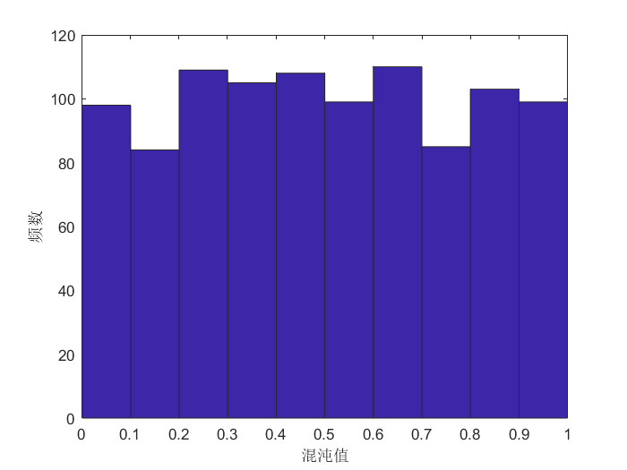
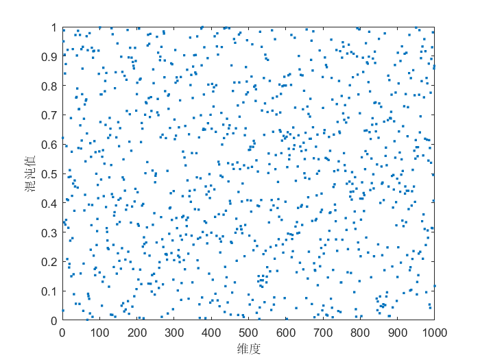
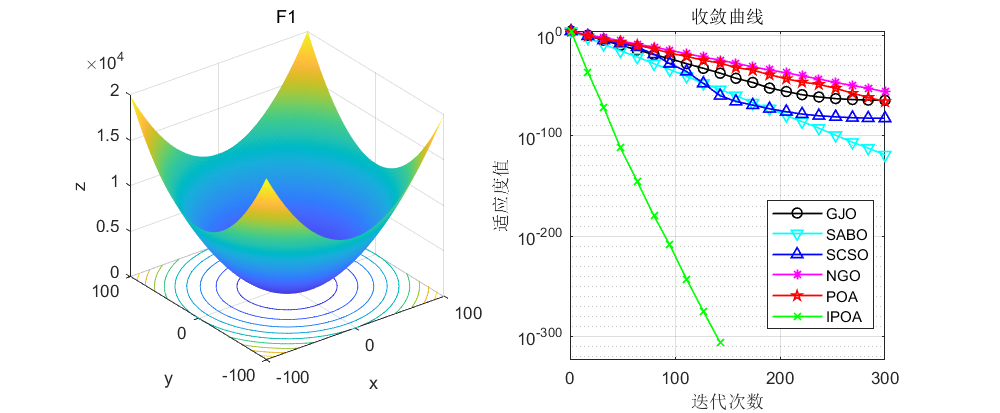
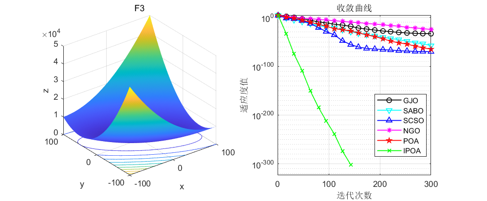
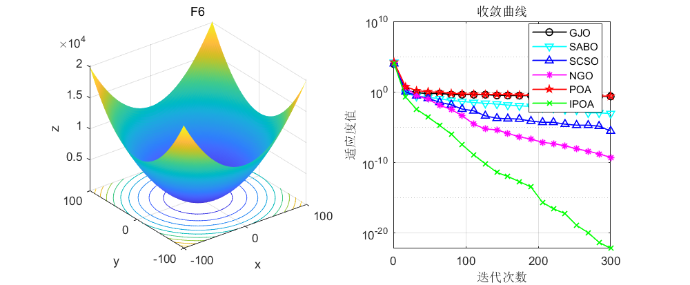
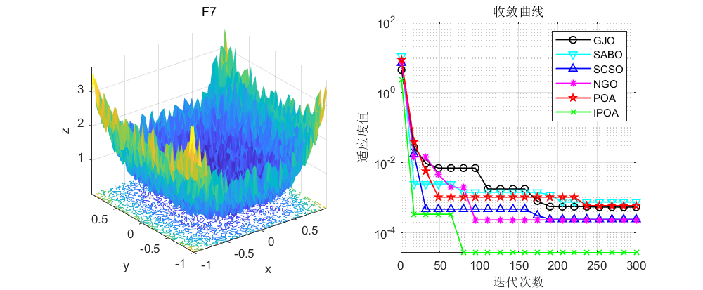
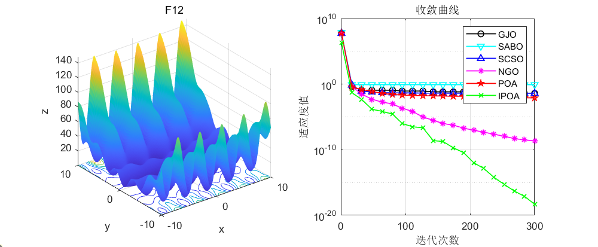
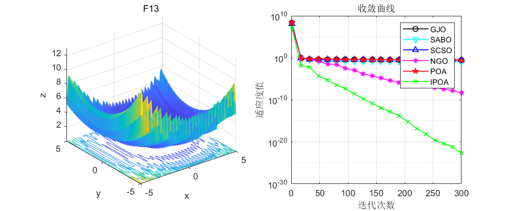
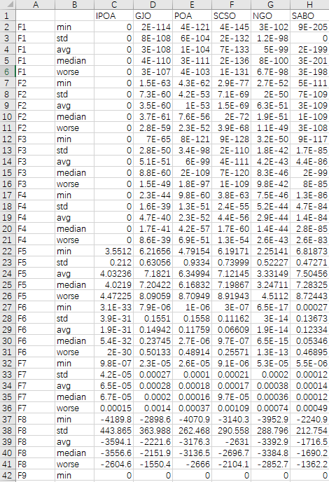
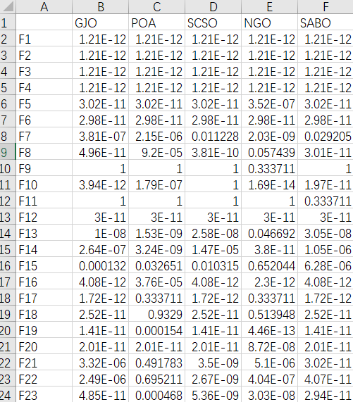
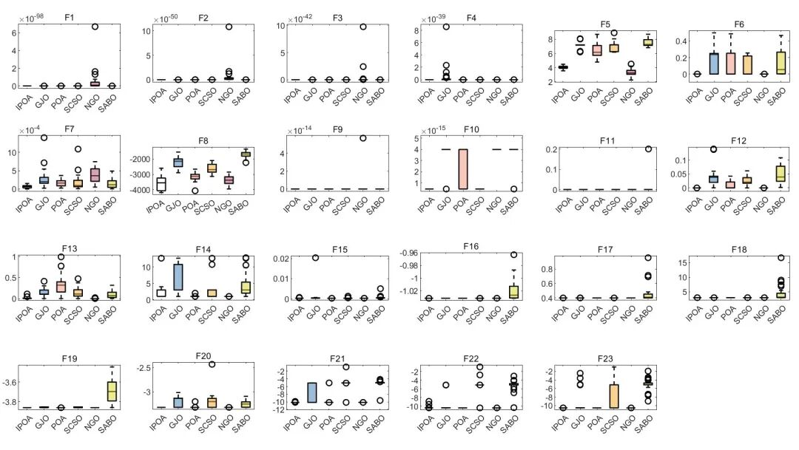
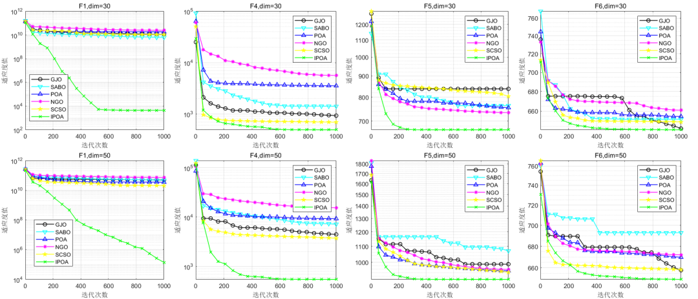
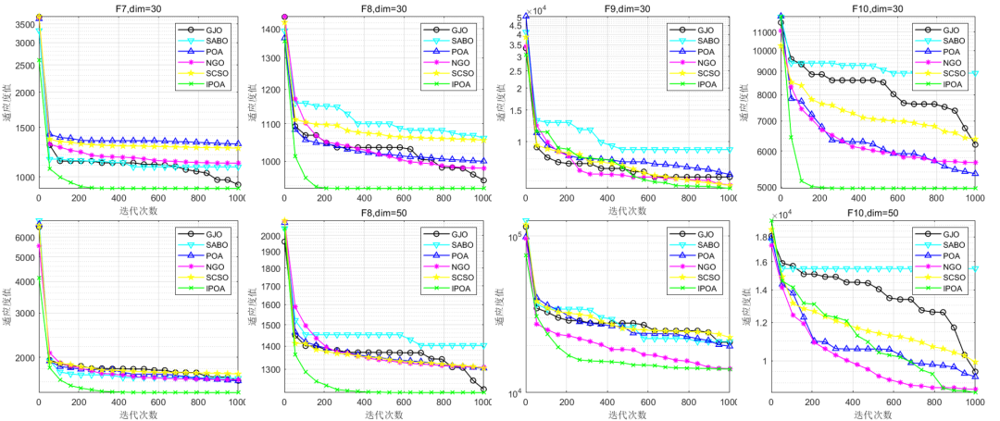
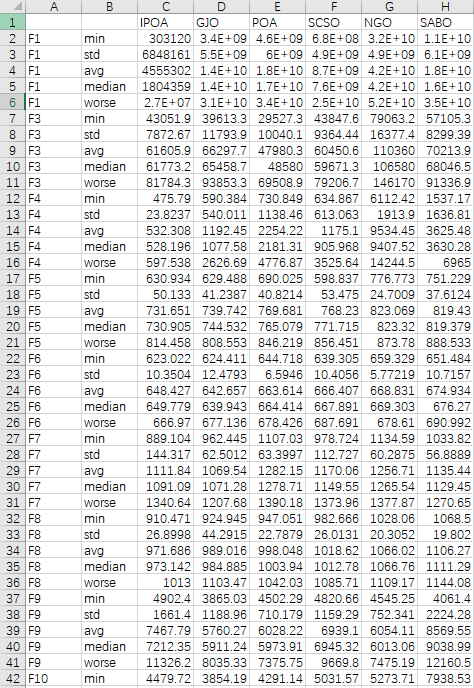
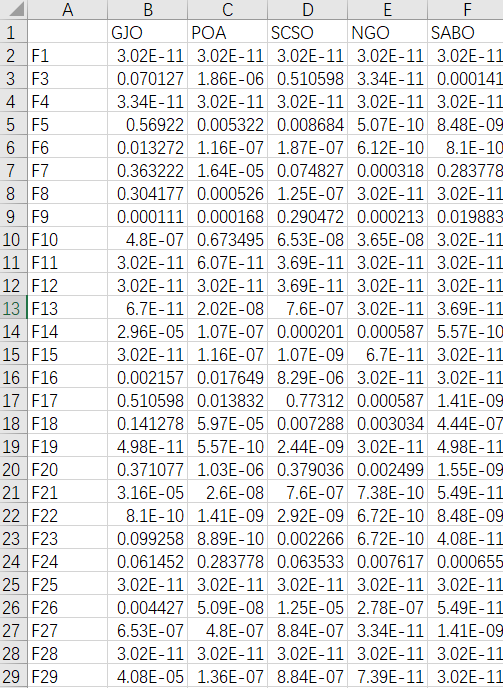
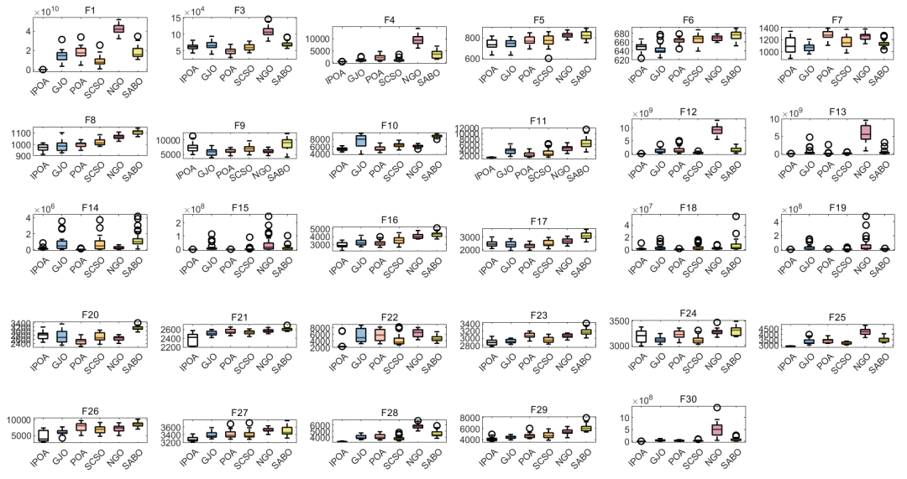
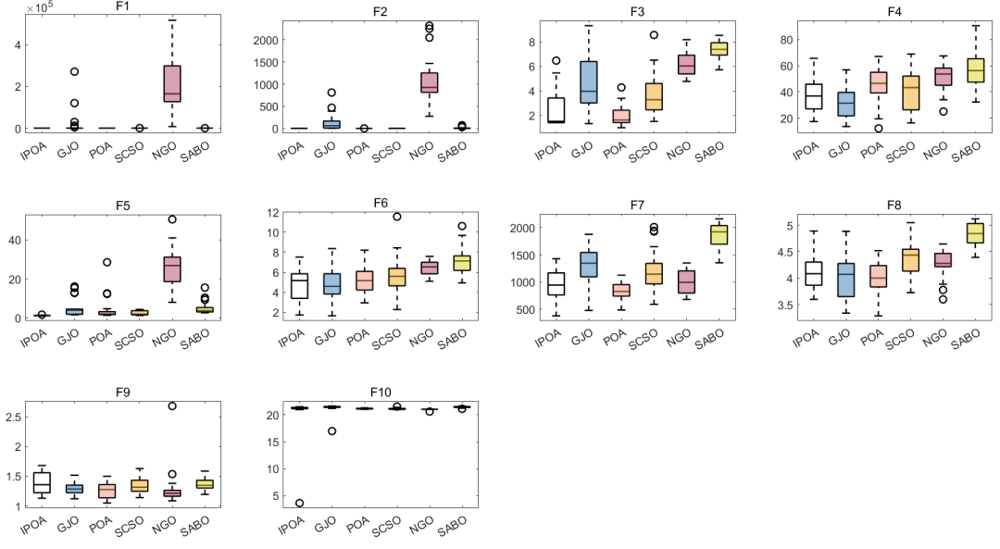
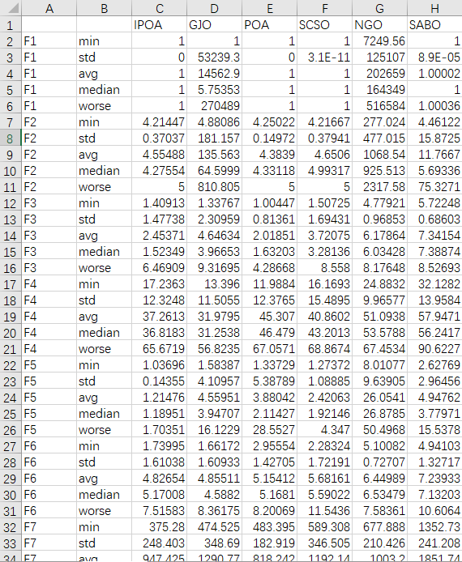
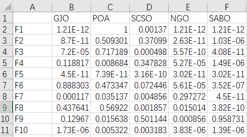
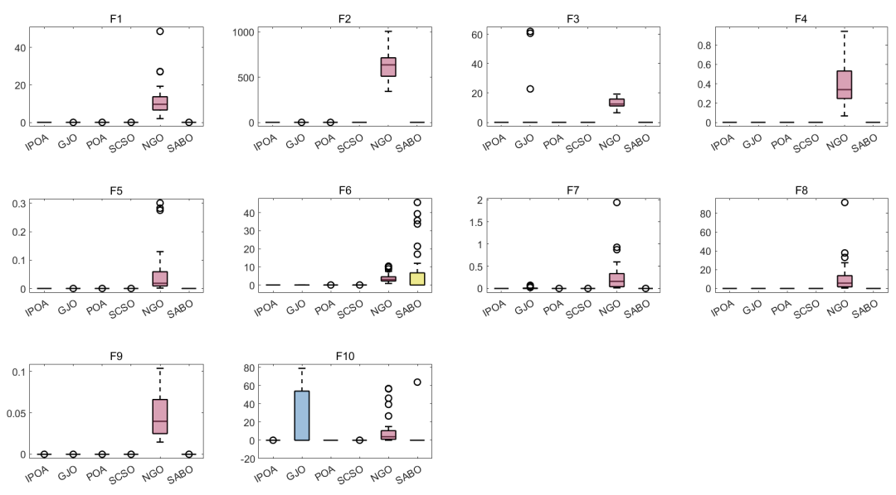
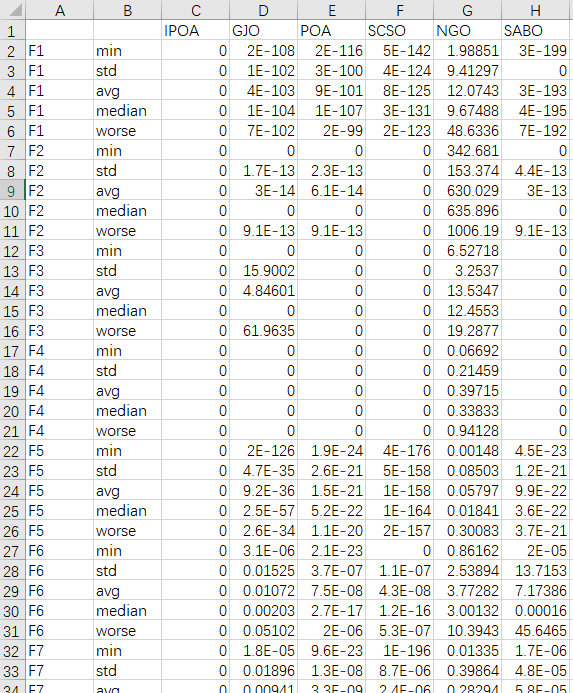
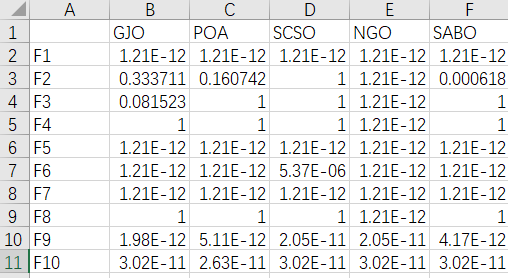
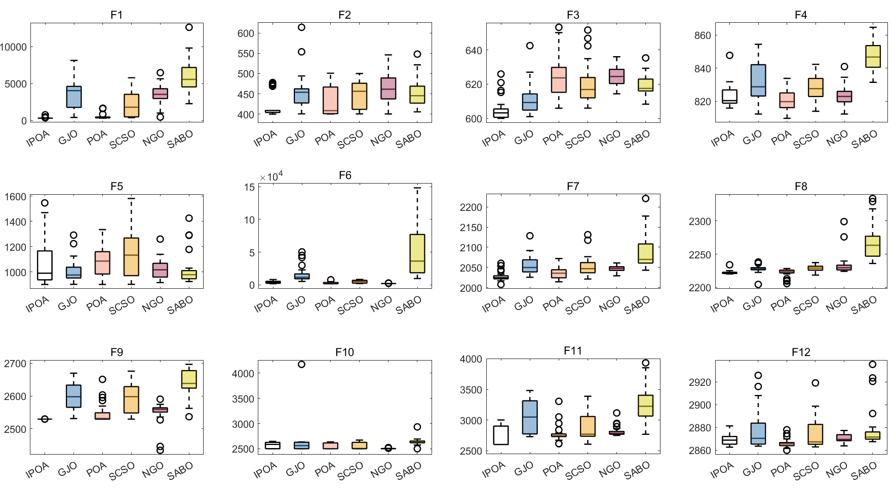

<!-- PAYMENT_BLOCK -->

## Get this dataset

- Payment link (Stripe): [Buy now](https://buy.stripe.com/3cs8yP7sY87d0vu9AB)
- Payment QR code: 

<!-- /PAYMENT_BLOCK -->
